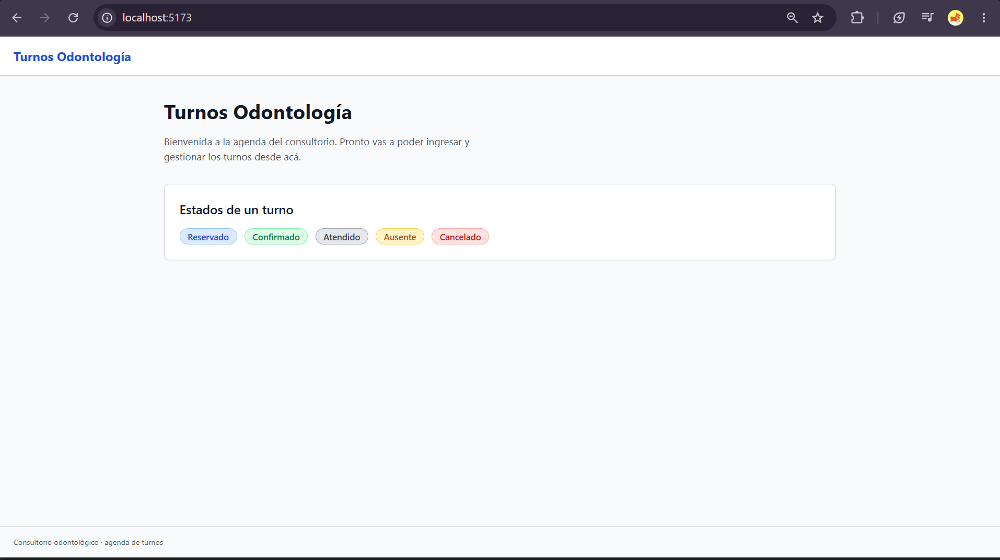

# Verificación de C-25 — frontend-base-react-vite

## Resultado

Todos los números salen de los archivos enlazados, generados por redirección.

- Tareas: 22/22 en [tasks.md](../../openspec/changes/archive/2026-11-07-frontend-base-react-vite/tasks.md).
- Vitest: 14 archivos, 47 tests en verde; `tsc` y ESLint sin errores ni warnings.
- Mutaciones: 47/47 hicieron fallar su test (una por test); mutaciones inválidas: 0; SHA-256 de producción intacto.
- Trazabilidad: 29 escenarios, 0 problemas.
- Backend: 895 passed tras actualizar el test de compose de C-18 (ver Desvíos).
- Precondición (GATE 15): [precondicion-C-25.txt](precondicion-C-25.txt); C-22, C-23 y C-24 archivados.
- Versiones instaladas (C2): [versiones-C-25.txt](versiones-C-25.txt).
- `tsc --noEmit` (strict): [tsc-C-25.txt](tsc-C-25.txt).
- ESLint (`--max-warnings 0`): [eslint-C-25.txt](eslint-C-25.txt).
- Vitest: [vitest-C-25.txt](vitest-C-25.txt).
- Mutaciones: [mutaciones-C-25.txt](mutaciones-C-25.txt), generado por [mutaciones-C-25.py](mutaciones-C-25.py).
- Trazabilidad: [trazabilidad-C-25.txt](trazabilidad-C-25.txt), generado por [trazabilidad-C-25.py](trazabilidad-C-25.py).
- Docker Compose y HMR: [docker-C-25.txt](docker-C-25.txt), generado por [docker-C-25.sh](docker-C-25.sh).
- Suite por defecto del backend tras agregar el servicio `frontend`: [backend-C-25.txt](backend-C-25.txt).
- Validación OpenSpec y `git diff --check`: [validate-C-25.txt](validate-C-25.txt).
- Rojos (TDD): carpeta [red-C-25/](red-C-25/).

## Contraste AA de los estados (D6)

Pares de `APPOINTMENT_STATUS_TOKENS` (`frontend/src/shared/styles/appointmentStatusTokens.ts`). El ratio lo calcula el test `cada par texto y fondo cumple contraste AA` con la fórmula de luminancia relativa de WCAG 2.x y lo compara redondeado a dos decimales; jsdom no mide contraste real, así que el test fija los valores y esta tabla los documenta.

| Estado | Texto | Fondo | Borde | Contraste texto/fondo | AA (>= 4.5:1) |
|--------|-------|-------|-------|----------------------|---------------|
| `reservado` | `#1D4ED8` | `#DBEAFE` | `#93C5FD` | 5.49:1 | sí |
| `confirmado` | `#15803D` | `#DCFCE7` | `#86EFAC` | 4.57:1 | sí |
| `atendido` | `#374151` | `#E5E7EB` | `#9CA3AF` | 8.33:1 | sí |
| `ausente` | `#B45309` | `#FEF3C7` | `#FCD34D` | 4.51:1 | sí |
| `cancelado` | `#B91C1C` | `#FEE2E2` | `#FCA5A5` | 5.30:1 | sí |

## Verificación manual

La autora abrió `http://localhost:5173` desde Docker Compose y vio el shell con los cinco estados ([capturas/C-25-home.png](capturas/C-25-home.png)). Se ejecutó `docker compose up -d --build frontend` (sin `down` ni `-v`) y luego [docker-C-25.sh](docker-C-25.sh); la salida cruda está en [docker-C-25.txt](docker-C-25.txt).

## Artefactos

- [proposal.md](../../openspec/changes/archive/2026-11-07-frontend-base-react-vite/proposal.md)
- [design.md](../../openspec/changes/archive/2026-11-07-frontend-base-react-vite/design.md)
- [tasks.md](../../openspec/changes/archive/2026-11-07-frontend-base-react-vite/tasks.md)
- [spec.md (frontend-foundation)](../../openspec/changes/archive/2026-11-07-frontend-base-react-vite/specs/frontend-foundation/spec.md)

## Desvíos

- **Se actualizó un test de C-18, con autorización de la autora (opción b).** `backend/tests/test_compose.py::test_compose_defines_services_without_literal_secrets` afirmaba `"frontend:" not in content`, escrito cuando el servicio todavía no existía; con el servicio de C-25 la suite por defecto daba 894 passed y 1 failed. Se reemplazó esa línea por afirmaciones positivas: el servicio `frontend` existe, publica `5173:5173`, no tiene `env_file` y su entorno no incluye `JWT_SECRET`, `POSTGRES_PASSWORD`, `POSTGRES_USER`, `DATABASE_URL` ni `SEED_USER_PASSWORD` (solo `VITE_API_URL` y `CHOKIDAR_USEPOLLING`). Es el único archivo de `backend/` tocado. Rojo con el compose anterior, que tenía `env_file: .env`, en `red-C-25/backend-compose.txt`; mutación a mano que le agrega `JWT_SECRET` al frontend, restaurada en un `finally`, en `red-C-25/backend-compose-mutacion.py`/`.txt`. Suite por defecto: 895 passed ([backend-C-25.txt](backend-C-25.txt)).
- **El servicio `frontend` ya no recibe el `.env` completo.** La tarea 6.1 y D11 pedían `env_file: .env`, pero eso le pasaba al contenedor todos los secretos. Se quitó: Compose interpola `VITE_API_URL` desde el `.env` de la raíz y el contenedor recibe solo esa variable y `CHOKIDAR_USEPOLLING` ([docker-C-25.txt](docker-C-25.txt): 0 variables secretas en el contenedor). `src/test/docker.test.ts` pasó de afirmar `env_file: .env` a afirmar que no está y que no aparece ningún secreto (rojo en `red-C-25/6.1-sin-env-file.txt`); las mutaciones y la trazabilidad se regeneraron después del cambio.
- **Dos archivos de test que `tasks.md` no nombra**: `src/test/tooling.test.ts` (los 3 escenarios de estructura y tooling, que no tienen tarea propia) y `src/test/docker.test.ts` (los 3 escenarios de Docker, escrito antes del Dockerfile en 6.1). Hacen falta para que los 28 escenarios tengan un test de Vitest. El rojo de tooling está en `red-C-25/0.2-tooling.txt` y, como typecheck y lint pasaron de entrada sobre el andamiaje, su mutación obligatoria en `red-C-25/0.2-mutacion.txt`.
- **7 mutaciones fuera de `frontend/src`**: las de tooling y Docker mutan `tsconfig.json`, `eslint.config.js`, `package.json` y `docker-compose.yml`, porque esos escenarios son de configuración; la tarea 7.4 pedía siempre `frontend/src`. El SHA-256 del script cubre `frontend/src` (sin tests) y esos archivos.
- **Invocación de Vitest en las mutaciones**: `node node_modules/vitest/vitest.mjs run <archivo> -t "<nombre>$"` en lugar de `npm run test:run -- <archivo>`, para correr solo el test de cada mutación sin pasar por el quoting de `cmd` en Windows. El detector usa además el reporter JSON.
- **Versiones (C2)**: Vitest 3.2.7 y no la última (5.x), porque Vitest 4+ exige Vite 6+; `@vitejs/plugin-react` 4.7.0 porque 5+/6+ exigen Vite más nuevo. ESLint no tenía major fijada: se instaló la última (10.14.0, con `@eslint/js` 10.0.1). `@types/node` 24 para coincidir con Node 24. jsdom 31 (dev) pide Node ^22.22 o ^24.15: el host (24.19.0) y `node:24-alpine` lo cumplen; `engines.node >= 20` queda como pide la spec para el runtime de la app.
- **npm**: `npm install` informó 17 vulnerabilidades. Son de dependencias de desarrollo (Vite 5 y esbuild) y solo afectan al servidor de desarrollo local, no al código que llega al navegador; arreglarlas exige saltar de major (fuera de SU-10) y queda fuera de C-25. npm 11 no ejecutó el `postinstall` de esbuild (`allow-scripts`); Vite funciona con el binario opcional de la plataforma.
- **`tokens.test.ts` lee los `.css` con `node:fs`**: Vitest reemplaza los `.css` importados (también con `?raw`) por cadenas vacías. El rojo de `red-C-25/1.2.txt` se tomó con la versión `?raw` del test (falló por archivo inexistente); el cambio a `fs` fue inmediato, antes del verde.
- **Refactor de tests después del verde**: `StatusBadge`, `EmptyState`, `PageShell`, `App` y el smoke pasaron de `getBy*` a `queryBy*` + `expect(...)` en el elemento que muta, para que las mutaciones fallen en una afirmación y no en un `TestingLibraryElementError`. Siguieron en verde.
- **Tests y comportamiento extra del cliente**: además de los escenarios, hay tests de 403, 422, cuerpo JSON y headers, y fallo de red (`status: 0`, `kind: "unknown"`, sin lanzar). Para `unknown`, `getApiErrorMessages` devuelve un mensaje propio del front, `Ocurrió un error inesperado (HTTP <status>).`, porque ese cuerpo no tiene contrato y mostrar el texto crudo (HTML) está descartado por D9. Ese mensaje no está en la spec: queda como comportamiento del front a especificar en C-26 o C-27.
- **Router**: `App` crea el router en un `useState` para leer la URL al montar; se activaron los flags `v7_*` de React Router 6 para evitar los avisos de deprecación.
- **`typecheck`** corre `tsc --noEmit` sobre `tsconfig.json` (src) y `tsconfig.node.json` (`vite.config.ts`), sin project references; `build` corre `typecheck` y luego `vite build`; `lint` es `eslint . --max-warnings 0`.
- **CSS Modules en tests** con `classNameStrategy: "non-scoped"` para poder afirmar la clase de variante (`reservado`, etc.).
- **`src/features/.gitkeep`**: la spec exige que exista `src/features/` y todavía no hay features (D14).
- **Docker**: `docker compose up -d --build frontend` también recreó el contenedor `backend` (dependencia). El HMR se comprobó sin navegador: se editó `HomePage.tsx` en el host, Vite sirvió el módulo nuevo al segundo y registró `[vite] hmr update /src/pages/HomePage.tsx`, sin reinicios del contenedor; el archivo se restauró. Falta que la autora lo vea en el navegador y saque las capturas.

## Mutaciones

<!-- mutaciones:inicio -->
| # | Test | Archivo | Mutación | Primera línea del fallo |
|---|---|---|---|---|
| 1 | `npm run typecheck falla con un tipo inválido` | `frontend/tsconfig.json` | `-  "include": ["src"] +  "include": ["src/shared"]` | `AssertionError: expected +0 not to be +0 // Object.is equality` |
| 2 | `npm run lint detecta una violación` | `frontend/eslint.config.js` | `-  { ignores: ["dist", "node_modules"] }, +  { ignores: ["dist", "node_modules", "src/**"]` | `AssertionError: expected +0 not to be +0 // Object.is equality` |
| 3 | `la estructura de carpetas y los scripts están presentes` | `frontend/package.json` | `-    "preview": "vite preview",` | `AssertionError: expected { …(8) } to match object { engines: { node: '>=20' }, …(1) }` |
| 4 | `monta App y muestra el título` | `frontend/src/pages/HomePage.tsx` | `-        <h1 className={styles.title}>Turnos Odontología</h1> +        <h1 className={styl` | `Error: expect(received).toBeInTheDocument()` |
| 5 | `el mapa cubre los cinco estados sin undefined` | `frontend/src/shared/styles/appointmentStatusTokens.ts` | `-export const APPOINTMENT_STATUSES = ["reservado", "confirmado", "atendido", "ausente", "c` | `AssertionError: expected [ 'reservado', 'confirmado', …(2) ] to deeply equal [ 'reservado'` |
| 6 | `cada par texto y fondo cumple contraste AA` | `frontend/src/shared/styles/appointmentStatusTokens.ts` | `-  ausente: { text: "#B45309", background: "#FEF3C7", border: "#FCD34D" }, +  ausente: { t` | `AssertionError: ausente: expected '#D97706' to be '#B45309' // Object.is equality` |
| 7 | `define la escala de espaciado 4/8/12/16/24/32/48 px` | `frontend/src/shared/styles/tokens.css` | `-  --space-5: 24px; +  --space-5: 20px;` | `AssertionError: expected [ '4px', '8px', '12px', '16px', …(3) ] to deeply equal [ '4px', '` |
| 8 | `define la tipografía 12/14/16/20/24/32 px` | `frontend/src/shared/styles/tokens.css` | `-  --font-size-lg: 20px; +  --font-size-lg: 18px;` | `AssertionError: expected [ Array(6) ] to deeply equal [ Array(6) ]` |
| 9 | `usa el system font stack en el reset` | `frontend/src/shared/styles/reset.css` | `-  font-family: var(--font-family-base); +  font-family: serif;` | `AssertionError: expected '*,\n*::before,\n*::after {\n  box-siz…' to match /body\s*\{[^}]*` |
| 10 | `el foco es visible` | `frontend/src/shared/styles/reset.css` | `-  outline: 2px solid var(--color-focus); +  outline: none;` | `AssertionError: expected '*,\n*::before,\n*::after {\n  box-siz…' to match /:focus-visible` |
| 11 | `el estado reservado muestra su variante` | `frontend/src/shared/components/StatusBadge.tsx` | `-  reservado: "Reservado", +  reservado: "Reservada",` | `Error: expect(received).toBeInTheDocument()` |
| 12 | `el estado confirmado muestra su variante` | `frontend/src/shared/components/StatusBadge.tsx` | `-  confirmado: "Confirmado", +  confirmado: "Confirmada",` | `Error: expect(received).toBeInTheDocument()` |
| 13 | `el estado atendido muestra su variante` | `frontend/src/shared/components/StatusBadge.tsx` | `-  atendido: "Atendido", +  atendido: "Atendida",` | `Error: expect(received).toBeInTheDocument()` |
| 14 | `el estado ausente muestra su variante` | `frontend/src/shared/components/StatusBadge.tsx` | `-  ausente: "Ausente", +  ausente: "Ausencia",` | `Error: expect(received).toBeInTheDocument()` |
| 15 | `el estado cancelado muestra su variante` | `frontend/src/shared/components/StatusBadge.tsx` | `-  cancelado: "Cancelado", +  cancelado: "Cancelada",` | `Error: expect(received).toBeInTheDocument()` |
| 16 | `renderiza su rol y su texto` | `frontend/src/shared/components/LoadingState.tsx` | `-export function LoadingState({ label = "Cargando..." }: LoadingStateProps) { +export func` | `Error: expect(element).toHaveTextContent()` |
| 17 | `con acción muestra el botón` | `frontend/src/shared/components/EmptyState.tsx` | `-        <button type="button" className={styles.action} onClick={action.onClick}> +      ` | `AssertionError: expected [] to deeply equal [ 'Crear turno' ]` |
| 18 | `sin acción no muestra botón` | `frontend/src/shared/components/EmptyState.tsx` | `-      
{description}
 +      
 ( +        {messages.slice(0, 1).map((message, ` | `AssertionError: expected [ Array(1) ] to deeply equal [ …(2) ]` |
| 20 | `muestra el mensaje de un 409 textual` | `frontend/src/shared/components/ErrorState.tsx` | `-          <li key={'${index}-${message}'}>{message}</li> +          <li key={'${index}-${` | `AssertionError: expected 'Dra. Laura Quiroga ya tiene un turno …' to be 'Dra. Laura Quirog` |
| 21 | `con reintento muestra el botón y lo ejecuta` | `frontend/src/shared/components/ErrorState.tsx` | `-        <button type="button" className={styles.retry} onClick={onRetry}> +        <butto` | `AssertionError: expected +0 to be 1 // Object.is equality` |
| 22 | `sin reintento no muestra botón` | `frontend/src/shared/components/ErrorState.tsx` | `-      {onRetry !== undefined && ( +      {(onRetry !== undefined \|\| messages.length > 0) ` | `Error: expect(element).not.toBeInTheDocument()` |
| 23 | `envuelve header, main y footer y renderiza sus hijos` | `frontend/src/shared/components/PageShell.tsx` | `-      <footer className={styles.footer}>Consultorio odontológico · agenda de turnos</foot` | `Error: expect(received).toBeInTheDocument()` |
| 24 | `una respuesta 200 devuelve ok con los datos` | `frontend/src/shared/api/client.ts` | `-      return { ok: true, status: response.status, data: parseJson(text) ?? null }; +     ` | `AssertionError: expected { ok: true, status: 200, data: null } to deeply equal { ok: true,` |
| 25 | `serializa el cuerpo como JSON y envía los headers de contenido` | `frontend/src/shared/api/client.ts` | `-      headers.set("Content-Type", "application/json"); +      headers.set("Content-Type",` | `AssertionError: expected 'text/plain' to be 'application/json' // Object.is equality` |
| 26 | `un 400 con errors se modela como validation` | `frontend/src/shared/api/client.ts` | `-    if (status === 400) { +    if (status === 418) {` | `AssertionError: expected { ok: false, status: 400, …(1) } to deeply equal { ok: false, sta` |
| 27 | `un 401 con code y message se modela como auth` | `frontend/src/shared/api/client.ts` | `-    if (status === 401 \|\| status === 404) { +    if (status === 404) {` | `AssertionError: expected { ok: false, status: 401, …(1) } to deeply equal { ok: false, sta` |
| 28 | `un 403 con violations se modela como forbidden` | `frontend/src/shared/api/client.ts` | `-        if (status === 403) return { kind: "forbidden", status, violations }; +        if` | `AssertionError: expected { ok: false, status: 403, …(1) } to deeply equal { ok: false, sta` |
| 29 | `un 409 con PROFESSIONAL_OVERLAP conserva el mensaje exacto` | `frontend/src/shared/api/client.ts` | `-        if (status === 409) return { kind: "conflict", status, violations }; +        if ` | `AssertionError: expected { kind: 'unprocessable', …(2) } to deeply equal { kind: 'conflict` |
| 30 | `un 422 con violations se modela como unprocessable` | `frontend/src/shared/api/client.ts` | `-        return { kind: "unprocessable", status, violations }; +        return { kind: "un` | `AssertionError: expected { ok: false, status: 422, …(1) } to deeply equal { ok: false, sta` |
| 31 | `un 404 con code y message se modela como not_found` | `frontend/src/shared/api/client.ts` | `-          : { kind: "not_found", status, code, message }; +          : { kind: "unknown",` | `AssertionError: expected { ok: false, status: 404, …(1) } to deeply equal { ok: false, sta` |
| 32 | `una respuesta desconocida se modela como unknown` | `frontend/src/shared/api/client.ts` | `-  return { kind: "unknown", status, rawText }; +  return { kind: "unknown", status, rawTe` | `AssertionError: expected { ok: false, status: 500, …(1) } to deeply equal { ok: false, sta` |
| 33 | `un fallo de red se modela como unknown con status 0 sin lanzar` | `frontend/src/shared/api/client.ts` | `-      return { ok: false, status: 0, error: { kind: "unknown", status: 0, rawText } }; + ` | `AssertionError: expected { ok: false, status: -1, …(1) } to deeply equal { ok: false, stat` |
| 34 | `devuelve errors[].message de un 400 en orden y tal cual` | `frontend/src/shared/api/errors.ts` | `-      return error.errors.map((fieldError) => fieldError.message); +      return error.er` | `AssertionError: expected [ 'startAt', 'durationMin' ] to deeply equal [ 'Falta este dato.'` |
| 35 | `devuelve message de un 401 tal cual` | `frontend/src/shared/api/errors.ts` | `-    case "auth": +    case "auth":` | `AssertionError: expected [ Array(1) ] to deeply equal [ 'Usuario o contraseña incorrectos.` |
| 36 | `devuelve violations[].message de un 409 con PROFESSIONAL_OVERLAP sin reformular` | `frontend/src/shared/api/errors.ts` | `-      return error.violations.map((violation) => violation.message); +      return error.` | `AssertionError: expected [ …(2) ] to deeply equal [ …(2) ]` |
| 37 | `devuelve violations[].message de un 403 y de un 422` | `frontend/src/shared/api/errors.ts` | `-    case "forbidden": -    case "unprocessable":` | `AssertionError: expected undefined to deeply equal [ Array(1) ]` |
| 38 | `devuelve message de un 404 tal cual` | `frontend/src/shared/api/errors.ts` | `+      return [error.message]; -      return [error.message];` | `AssertionError: expected [ Array(1) ] to deeply equal [ 'Turno no encontrado.' ]` |
| 39 | `un error unknown devuelve un mensaje genérico con el status, sin el texto crudo` | `frontend/src/shared/api/errors.ts` | `-      return ['Ocurrió un error inesperado (HTTP ${error.status}).']; +      return ['Ocu` | `AssertionError: expected [ Array(1) ] to deeply equal [ Array(1) ]` |
| 40 | `sin provider no se envía Authorization` | `frontend/src/shared/api/auth.ts` | `-let currentProvider: AuthProvider \| null = null; +let currentProvider: AuthProvider \| nul` | `AssertionError: expected true to be false // Object.is equality` |
| 41 | `con provider se agrega el Bearer` | `frontend/src/shared/api/client.ts` | `-      headers.set("Authorization", 'Bearer ${token}'); +      headers.set("Authorization"` | `AssertionError: expected 'token-ficticio-123' to be 'Bearer token-ficticio-123' // Object.` |
| 42 | `C-25 no persiste el token` | `frontend/src/shared/api/auth.ts` | `-  return currentProvider?.getToken() ?? null; +  return currentProvider?.getToken() ?? lo` | `AssertionError: expected [ 'shared\api\auth.ts' ] to deeply equal []` |
| 43 | `la ruta raíz renderiza el HomePage de bienvenida` | `frontend/src/pages/HomePage.tsx` | `-          {APPOINTMENT_STATUSES.map((status) => ( +          {APPOINTMENT_STATUSES.slice(` | `AssertionError: expected [ 'Confirmado', 'Atendido', …(2) ] to deeply equal [ 'Reservado',` |
| 44 | `una ruta desconocida muestra la página de no encontrada` | `frontend/src/App.tsx` | `-  { path: "*", element: <NotFoundPage /> }, +  { path: "*", element: <HomePage /> },` | `Error: expect(received).toBeInTheDocument()` |
| 45 | `docker compose up levanta el frontend en 5173` | `docker-compose.yml` | `-      - "5173:5173" +      - "5174:5173"` | `AssertionError: expected '    build: ./frontend\n    # No recib…' to contain '- "5173:5173` |
| 46 | `un cambio de archivo se refleja por HMR en Windows` | `docker-compose.yml` | `-      CHOKIDAR_USEPOLLING: "true" +      CHOKIDAR_USEPOLLING: "false"` | `AssertionError: expected '    build: ./frontend\n    # No recib…' to contain 'CHOKIDAR_USE` |
| 47 | `VITE_API_URL del navegador apunta a localhost` | `docker-compose.yml` | `-      VITE_API_URL: ${VITE_API_URL:-http://localhost:8000/api} +      VITE_API_URL: http:` | `AssertionError: expected '    build: ./frontend\n    # No recib…' to contain 'VITE_API_URL` |
<!-- mutaciones:fin -->

## Trazabilidad

<!-- trazabilidad:inicio -->
| # | Requisito | Escenario | Test |
|---|---|---|---|
| 1 | Estructura y tooling del frontend | npm run typecheck falla con un tipo inválido | `src/test/tooling.test.ts > npm run typecheck falla con un tipo inválido` |
| 2 | Estructura y tooling del frontend | npm run lint detecta una violación | `src/test/tooling.test.ts > npm run lint detecta una violación` |
| 3 | Estructura y tooling del frontend | La estructura de carpetas y los scripts están presentes | `src/test/tooling.test.ts > la estructura de carpetas y los scripts están presentes` |
| 4 | Tokens de diseño y colores por estado | El mapa cubre los cinco estados sin undefined | `src/shared/styles/appointmentStatusTokens.test.ts > el mapa cubre los cinco estados sin undefined` |
| 5 | Tokens de diseño y colores por estado | Cada par texto y fondo cumple contraste AA | `src/shared/styles/appointmentStatusTokens.test.ts > cada par texto y fondo cumple contraste AA` |
| 6 | Tokens de diseño y colores por estado | El foco es visible | `src/shared/styles/tokens.test.ts > el foco es visible` |
| 7 | StatusBadge | El estado reservado muestra su variante | `src/shared/components/StatusBadge.test.tsx > el estado reservado muestra su variante` |
| 8 | StatusBadge | El estado confirmado muestra su variante | `src/shared/components/StatusBadge.test.tsx > el estado confirmado muestra su variante` |
| 9 | StatusBadge | El estado atendido muestra su variante | `src/shared/components/StatusBadge.test.tsx > el estado atendido muestra su variante` |
| 10 | StatusBadge | El estado ausente muestra su variante | `src/shared/components/StatusBadge.test.tsx > el estado ausente muestra su variante` |
| 11 | StatusBadge | El estado cancelado muestra su variante | `src/shared/components/StatusBadge.test.tsx > el estado cancelado muestra su variante` |
| 12 | Estados base de carga, vacío y error | LoadingState renderiza su rol y su texto | `src/shared/components/LoadingState.test.tsx > renderiza su rol y su texto` |
| 13 | Estados base de carga, vacío y error | EmptyState con acción muestra el botón | `src/shared/components/EmptyState.test.tsx > con acción muestra el botón` |
| 14 | Estados base de carga, vacío y error | EmptyState sin acción no muestra botón | `src/shared/components/EmptyState.test.tsx > sin acción no muestra botón` |
| 15 | Estados base de carga, vacío y error | ErrorState muestra uno y varios mensajes | `src/shared/components/ErrorState.test.tsx > muestra uno y varios mensajes` |
| 16 | Estados base de carga, vacío y error | ErrorState muestra el mensaje de un 409 textual | `src/shared/components/ErrorState.test.tsx > muestra el mensaje de un 409 textual` |
| 17 | Cliente de API y las cuatro formas de error | Una respuesta 200 devuelve ok con los datos | `src/shared/api/client.test.ts > una respuesta 200 devuelve ok con los datos` |
| 18 | Cliente de API y las cuatro formas de error | Un 400 con errors se modela como validation | `src/shared/api/client.test.ts > un 400 con errors se modela como validation ; src/shared/api/errors.test.ts > devuelve errors[].message de un 400 en orden y tal cual` |
| 19 | Cliente de API y las cuatro formas de error | Un 401 con code y message se modela como auth | `src/shared/api/client.test.ts > un 401 con code y message se modela como auth ; src/shared/api/errors.test.ts > devuelve message de un 401 tal cual` |
| 20 | Cliente de API y las cuatro formas de error | Un 409 con PROFESSIONAL_OVERLAP conserva el mensaje exacto | `src/shared/api/client.test.ts > un 409 con PROFESSIONAL_OVERLAP conserva el mensaje exacto ; src/shared/api/errors.test.ts > devuelve violations[].message de un 409 con PROFESSIONAL_OVERLAP sin reformular` |
| 21 | Cliente de API y las cuatro formas de error | Un 404 con code y message se modela como not_found | `src/shared/api/client.test.ts > un 404 con code y message se modela como not_found ; src/shared/api/errors.test.ts > devuelve message de un 404 tal cual` |
| 22 | Cliente de API y las cuatro formas de error | Una respuesta desconocida se modela como unknown | `src/shared/api/client.test.ts > una respuesta desconocida se modela como unknown` |
| 23 | Punto de enganche del token para C-26 | Sin provider no se envía Authorization | `src/shared/api/auth.test.ts > sin provider no se envía Authorization` |
| 24 | Punto de enganche del token para C-26 | Con provider se agrega el Bearer | `src/shared/api/auth.test.ts > con provider se agrega el Bearer` |
| 25 | Punto de enganche del token para C-26 | C-25 no persiste el token | `src/shared/api/auth.test.ts > C-25 no persiste el token` |
| 26 | Servicio frontend en Docker Compose | docker compose up levanta el frontend en 5173 | `src/test/docker.test.ts > docker compose up levanta el frontend en 5173` |
| 27 | Servicio frontend en Docker Compose | Un cambio de archivo se refleja por HMR en Windows | `src/test/docker.test.ts > un cambio de archivo se refleja por HMR en Windows` |
| 28 | Servicio frontend en Docker Compose | VITE_API_URL del navegador apunta a localhost | `src/test/docker.test.ts > VITE_API_URL del navegador apunta a localhost` |
| 29 | Servicio frontend en Docker Compose | El servicio frontend no recibe secretos | `src/test/docker.test.ts > docker compose up levanta el frontend en 5173` |
<!-- trazabilidad:fin -->
