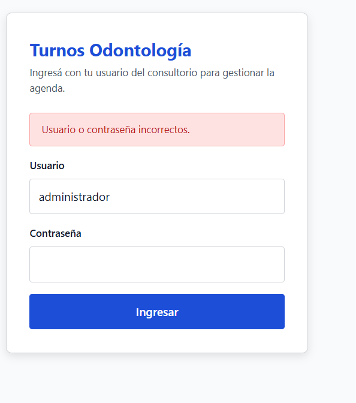
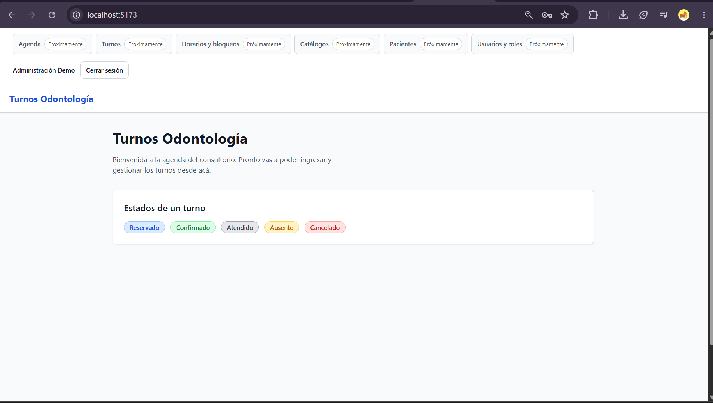
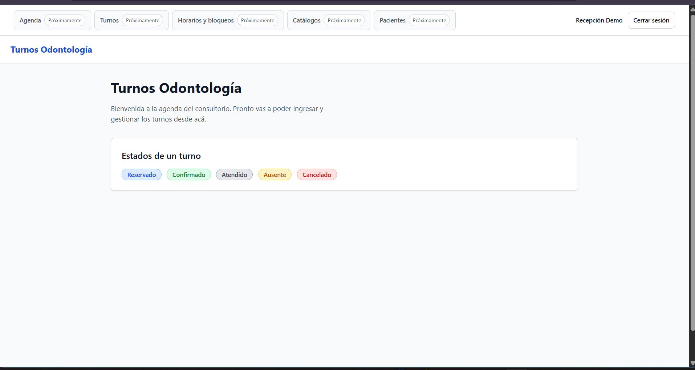
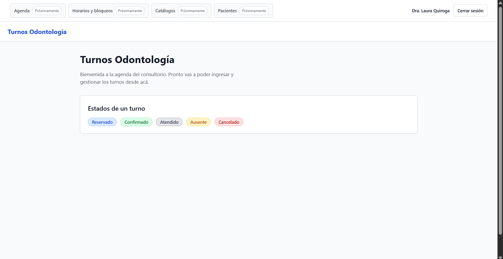
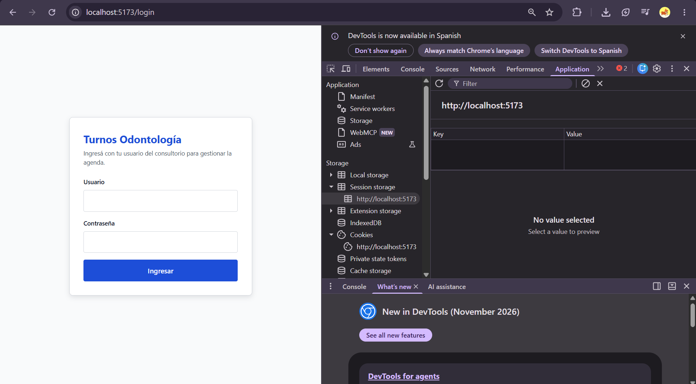

# Verificación de C-26 — ui-login-y-sesion

## Resultado

Todos los números salen de los archivos enlazados, generados por redirección.

- Tareas: 18/18 en [tasks.md](../../openspec/changes/archive/2026-11-07-ui-login-y-sesion/tasks.md).
- Vitest: 23 archivos, 85 tests en verde (47 de C-25 + 38 nuevos de C-26); `tsc` y ESLint sin errores ni warnings.
- Mutaciones: 38/38 hicieron fallar su test (una por cada test nuevo de C-26); mutaciones inválidas: 0; SHA-256 de producción intacto.
- Trazabilidad: 29 escenarios, 0 problemas.
- Precondición (GATE 16): [precondicion-C-26.txt](precondicion-C-26.txt); C-25 y C-19 archivados.
- Línea de base desde `frontend/`: [baseline-C-26.txt](baseline-C-26.txt) (47 passed, `tsc` y ESLint limpios).
- `tsc --noEmit` (strict): [tsc-C-26.txt](tsc-C-26.txt).
- ESLint (`--max-warnings 0`): [eslint-C-26.txt](eslint-C-26.txt).
- Vitest: [vitest-C-26.txt](vitest-C-26.txt).
- Mutaciones: [mutaciones-C-26.txt](mutaciones-C-26.txt), generado por [mutaciones-C-26.py](mutaciones-C-26.py).
- Trazabilidad: [trazabilidad-C-26.txt](trazabilidad-C-26.txt), generado por [trazabilidad-C-26.py](trazabilidad-C-26.py).
- Verificación HTTP contra backend real: [http-C-26.txt](http-C-26.txt) y [manual-C-26.txt](manual-C-26.txt).
- Validación OpenSpec y `git diff --check`: [validate-C-26.txt](validate-C-26.txt).
- Rojos (TDD): carpeta [red-C-26/](red-C-26/).

## Seguridad y gobernanza ALTO (D1, D2, D7, D9, D12, D13, D14)

### XSS y `sessionStorage`

- El token JWT se almacena únicamente detrás de la interfaz `TokenStore` en `frontend/src/features/auth/tokenStore.ts` bajo la clave `turnos.auth.accessToken` en `sessionStorage`, con espejo en memoria y degradación transparente a memoria si `sessionStorage` lanza (`SecurityError` / `QuotaExceededError`).
- Al vivir en `sessionStorage`, el token queda aislado por pestaña, no sobrevive al cierre del navegador y no se comparte entre pestañas nuevas. Sigue siendo legible por JavaScript del mismo origen ante un eventual XSS; el riesgo se acota no usando `dangerouslySetInnerHTML`, `eval` ni scripts de terceros, fijando dependencias en `package-lock.json` y manteniendo vida corta (`JWT_EXPIRES_MIN`). El riesgo residual se acepta explícitamente (D1).

### Qué no se guarda

- Nunca se persisten en `sessionStorage`, `localStorage` ni cookies: la contraseña, el usuario (`CurrentUser`), el `role`, el `professionalId` ni el último nombre de usuario ingresado.
- La identidad (`id`, `username`, `displayName`, `role`, `professionalId`) se obtiene siempre de `GET /api/auth/me` y vive solo en memoria de React (`AuthContext`), sin exponer el string del token en el estado de React DevTools.
- El campo de contraseña se vacía inmediatamente tras cada intento de login.
- En el logout manual solo se elimina la clave propia `turnos.auth.accessToken` (`removeItem`), nunca `sessionStorage.clear()` global; el token emitido por el servidor continúa siendo criptográficamente válido hasta su `exp` porque el MVP no tiene lista de revocación en servidor (D7, SU-06).

### Qué no se loguea

- Ningún archivo de producción en `frontend/src` invoca `console.*`.
- No se loguean credenciales, contraseñas, tokens, headers `Authorization` ni cuerpos de respuesta.
- Los mensajes de error de la UI nunca interpolan el token ni muestran JSON crudo.
- El destino post-login (`from`) viaja en `location.state` y se valida con `safeInternalPath` (debe comenzar con `/`, no con `//`, no ser `/login` ni una URL absoluta; en caso contrario cae a `/`).

### Por qué no cookies

- El backend (`POST /api/auth/login`, C-19) devuelve `{ accessToken, tokenType: "bearer" }` en el cuerpo JSON y espera `Authorization: Bearer <token>`; no emite cookies `Set-Cookie`. Crear una cookie desde JavaScript no sería `HttpOnly` y sumaría superficie CSRF sin beneficio frente a `sessionStorage`. Migrar a cookie `HttpOnly` requeriría modificar el backend, CORS con credenciales y protección CSRF, fuera del alcance de C-26.

### Ajuste del guardián de C-25 (D14)

- En `frontend/src/shared/api/auth.test.ts` se acotó el test `C-25 no persiste el token` con una allowlist explícita únicamente para `features/auth/tokenStore.ts` sobre `sessionStorage`, manteniendo la prohibición total de `localStorage` y `document.cookie` en todo `frontend/src` y sumando el guardián específico de C-26 en `frontend/src/features/auth/storageGuard.test.ts` (con mutación obligatoria en [red-C-26/1.2-mutacion.txt](red-C-26/1.2-mutacion.txt)).

### Confirmación de alcance e inmutabilidad fuera del front

- No se modificó ningún archivo de `backend/`, migraciones, `openspec/specs/`, `knowledge-base/`, `CHANGES.md`, `.env` ni `docker-compose.yml` durante el apply (en el archive se sincronizó `openspec/specs/frontend-auth-session/spec.md` y se actualizaron `CHANGES.md`, `README.md` y `knowledge-base/06_funcionalidades.md`).

## Verificación manual en el navegador (2026-11-07)

Con Docker Compose levantado (`VITE_API_URL=http://localhost:8000/api`), se verificó por HTTP ([http-C-26.txt](http-C-26.txt) / [manual-C-26.txt](manual-C-26.txt)) y la autora probó el flujo en el navegador en `http://localhost:5173`, tomando las siguientes capturas en `docs/evidencias/capturas/`:

- **Credenciales inválidas (mensaje genérico)**: [capturas/C-26-error.png](capturas/C-26-error.png) — muestra exactamente `"Usuario o contraseña incorrectos."` en el alerta, vacía el campo de contraseña y no revela qué credencial falló.
- **Menú de administración (6 ítems)**: [capturas/C-26-administrador.png](capturas/C-26-administrador.png) — sesión iniciada como `administrador` (`Administración Demo`), con los 6 ítems (`Agenda`, `Turnos`, `Horarios y bloqueos`, `Catálogos`, `Pacientes`, `Usuarios y roles`) deshabilitados con `"Próximamente"` y botón `"Cerrar sesión"`.
- **Menú de recepción (5 ítems)**: [capturas/C-26-recepcion.png](capturas/C-26-recepcion.png) — sesión iniciada como `recepcion` (`Recepción Demo`), con los 5 ítems de su rol (sin `Usuarios y roles`).
- **Menú de la odontóloga (4 ítems)**: [capturas/C-26-odontologo.png](capturas/C-26-odontologo.png) — sesión iniciada como `odontologo` (`Dra. Laura Quiroga`), con los 4 ítems de su rol (sin `Turnos` ni `Usuarios y roles`).
- **Token adulterado + recarga (`/me` responde `401`)**: [capturas/C-26-sesion-vencida.png](capturas/C-26-sesion-vencida.png) — al adulterar el token en `sessionStorage` y recargar la página, `GET /api/auth/me` responde `401`, se descarta el token y la aplicación vuelve a `/login` sin mensaje de sesión vencida, tal como exige el escenario `"/me responde 401 y limpia la sesión"`.

> **Nota sobre el mensaje de sesión vencida durante el uso:** el mensaje `"La sesión venció. Iniciá sesión de nuevo."` cuando una petición protegida responde `401` con la sesión ya iniciada se verificará a mano en el navegador en **C-27**, porque C-26 todavía no tiene pantallas de negocio que disparen peticiones protegidas tras el arranque; en C-26 su comportamiento está cubierto por tests automatizados (`src/App.test.tsx > token vencido en una request protegida` y `src/features/auth/AuthContext.test.tsx > lastEvent registra expired ante 401 protegido y manual ante logout`).

## Desvíos

- **`AbortController` y `AbortSignal` nativos de Node en `frontend/src/test/setup.ts` (no es un mock)**: jsdom 31 instala su propia implementación de `window.AbortController`/`AbortSignal`, mientras que Node 24 provee el `Request` nativo de `undici`, cuyo constructor exige que `RequestInit.signal` sea una instancia del `AbortSignal` nativo de Node. Al ejecutar navegaciones (`<Navigate />` / `navigate`) en React Router 6 dentro de Vitest, `@remix-run/router` construye `new Request(url, { signal })` y fallaba con `TypeError: RequestInit: Expected signal ("AbortSignal {}") to be an instance of AbortSignal`. Se resolvió en `frontend/src/test/setup.ts` reemplazando el `AbortController`/`AbortSignal` de jsdom por la implementación real nativa de Node 24 obtenida con `transferableAbortController()` de `node:util` (no es un mock ni un espía: sustituye la clase de jsdom por la implementación real del runtime por una incompatibilidad entre jsdom 31 y Node 24).
- **Dos `eslint-disable-next-line react-refresh/only-export-components` puntuales**: `eslint . --max-warnings 0` activa la regla `react-refresh/only-export-components` como warning cuando un archivo `.tsx` exporta además de un componente una función o constante auxiliar. Como `design.md` (D4 y D8) indica exportar `useAuth` desde `AuthContext.tsx` y `routes` desde `App.tsx`, se colocaron esos dos `eslint-disable` puntuales para mantener 0 warnings en ESLint.

## Artefactos

- [proposal.md](../../openspec/changes/archive/2026-11-07-ui-login-y-sesion/proposal.md)
- [design.md](../../openspec/changes/archive/2026-11-07-ui-login-y-sesion/design.md)
- [tasks.md](../../openspec/changes/archive/2026-11-07-ui-login-y-sesion/tasks.md)
- [spec.md (frontend-auth-session)](../../openspec/changes/archive/2026-11-07-ui-login-y-sesion/specs/frontend-auth-session/spec.md)

## Mutaciones

<!-- mutaciones:inicio -->
| # | Test | Archivo | Mutación | Primera línea del fallo |
|---|---|---|---|---|
| 1 | `guardar y leer el token de la pestaña` | `frontend/src/features/auth/tokenStore.ts` | `-export const ACCESS_TOKEN_STORAGE_KEY = "turnos.auth.accessToken"; +export const ACCESS_T` | `AssertionError: expected 'turnos.auth.otroToken' to be 'turnos.auth.accessToken' // Object` |
| 2 | `limpiar el token` | `frontend/src/features/auth/tokenStore.ts` | `-      storage.removeItem(ACCESS_TOKEN_STORAGE_KEY); +      storage.setItem(ACCESS_TOKEN_S` | `AssertionError: expected 'sin-borrar' to be null` |
| 3 | `fallback a memoria si el almacenamiento falla` | `frontend/src/features/auth/tokenStore.ts` | `-    memoryToken = token; +    memoryToken = null;` | `AssertionError: expected null to be 'token-ficticio-123' // Object.is equality` |
| 4 | `createMemoryTokenStore aísla cada instancia sin tocar sessionStorage` | `frontend/src/features/auth/tokenStore.ts` | `-  let currentToken: string \| null = initialToken; +  let currentToken: string \| null = nu` | `AssertionError: expected null to be 'token-inicial' // Object.is equality` |
| 5 | `el storage está confinado a un solo archivo` | `frontend/src/features/auth/tokenStore.ts` | `-  storage: StorageLike \| undefined = typeof window !== "undefined" ? window.sessionStorag` | `AssertionError: expected [ 'features/auth/tokenStore.ts' ] to deeply equal []` |
| 6 | `login envía POST /api/auth/login y devuelve el accessToken con 200` | `frontend/src/features/auth/authApi.ts` | `-const LOGIN_PATH = "/auth/login"; +const LOGIN_PATH = "/auth/signin";` | `AssertionError: expected 'http://localhost:8000/api/auth/signin' to be 'http://localhost:8` |
| 7 | `login devuelve error auth ante 401 INVALID_CREDENTIALS` | `frontend/src/features/auth/authApi.ts` | `-    return { kind: "auth", status: error.status, code: error.code, message: error.message` | `AssertionError: expected { ok: false, status: 401, …(1) } to deeply equal { ok: false, sta` |
| 8 | `login devuelve error validation ante 400 con errors` | `frontend/src/features/auth/authApi.ts` | `-    return { kind: "validation", status: error.status, errors: error.errors }; +    retur` | `AssertionError: expected { ok: false, status: 400, …(1) } to deeply equal { ok: false, sta` |
| 9 | `el login no manda un token viejo` | `frontend/src/features/auth/authApi.ts` | `-    auth: "omit", +    auth: "auto",` | `AssertionError: expected true to be false // Object.is equality` |
| 10 | `petición autenticada con Bearer` | `frontend/src/features/auth/authApi.ts` | `-const ME_PATH = "/auth/me"; +const ME_PATH = "/auth/current";` | `AssertionError: expected 'http://localhost:8000/api/auth/current' to be 'http://localhost:` |
| 11 | `sin token no se envía Authorization` | `frontend/src/shared/api/client.ts` | `-    if (token !== null) { +    if (token !== undefined) {` | `AssertionError: expected true to be false // Object.is equality` |
| 12 | `fetchMe devuelve error auth ante 401 INVALID_TOKEN y error unknown ante red o 5xx` | `frontend/src/features/auth/authApi.ts` | `-    return { kind: "auth", status: error.status, code: error.code, message: error.message` | `AssertionError: expected { ok: false, status: 401, …(1) } to deeply equal { ok: false, sta` |
| 13 | `estado checking mientras se verifica la sesión` | `frontend/src/features/auth/AuthContext.tsx` | `-    store.getToken() !== null ? "checking" : "anonymous", +    store.getToken() !== null ` | `Error: expect(received).toHaveTextContent()` |
| 14 | `sesión autenticada con el usuario de /me` | `frontend/src/features/auth/AuthContext.tsx` | `-        setUser(result.data); +        setUser(null);` | `Error: expect(element).toHaveTextContent()` |
| 15 | `/me responde 401 y limpia la sesión` | `frontend/src/features/auth/AuthContext.tsx` | `-        store.clear(); +        void store;` | `AssertionError: expected 'token-vencido' to be null` |
| 16 | `error de red en /me conserva el token y permite reintentar` | `frontend/src/features/auth/AuthContext.tsx` | `-      setBootstrapError([NETWORK_ERROR_MESSAGE]); +      setBootstrapError(["Error distin` | `Error: expect(element).toHaveTextContent()` |
| 17 | `lastEvent registra expired ante 401 protegido y manual ante logout` | `frontend/src/features/auth/AuthContext.tsx` | `-    setLastEvent("expired"); +    setLastEvent(null);` | `Error: expect(element).toHaveTextContent()` |
| 18 | `rol sin permiso muestra la violación ante 403 sin cerrar sesión ni refrescar /me` | `frontend/src/features/auth/AuthContext.tsx` | `-            setActionErrors(getApiErrorMessages(result.error)); +            setActionErr` | `Error: expect(received).toHaveTextContent()` |
| 19 | `acepta una ruta interna con query string como /agenda?date=2026-11-07` | `frontend/src/features/auth/safeInternalPath.ts` | `-  return candidate; +  return "/";` | `AssertionError: expected '/' to be '/agenda?date=2026-11-07' // Object.is equality` |
| 20 | `se rechaza una ruta protocol-relative` | `frontend/src/features/auth/safeInternalPath.ts` | `-  if (candidate.startsWith("//")) { +  if (candidate.startsWith("///")) {` | `AssertionError: expected '//evil.com' to be '/' // Object.is equality` |
| 21 | `se rechaza una URL absoluta` | `frontend/src/features/auth/safeInternalPath.ts` | `-  if (typeof candidate !== "string" \|\| candidate === "" \|\| !candidate.startsWith("/")) { ` | `AssertionError: expected 'https://evil.example' to be '/' // Object.is equality` |
| 22 | `se rechaza volver al propio login` | `frontend/src/features/auth/safeInternalPath.ts` | `-  if (candidate === "/login" \|\| candidate.startsWith("/login?") \|\| candidate.startsWith("` | `AssertionError: expected '/login' to be '/' // Object.is equality` |
| 23 | `ruta protegida sin sesión conserva el destino` | `frontend/src/features/auth/RequireAuth.tsx` | `-          from: '${location.pathname}${location.search}', +          from: location.pathn` | `AssertionError: expected { from: '/agenda', expired: false } to deeply equal { …(2) }` |
| 24 | `login con sesión vuelve al destino válido` | `frontend/src/features/auth/PublicOnlyRoute.tsx` | `-    const destination = safeInternalPath(extractFromPath(location.state)); +    const des` | `AssertionError: expected '/' to be '/agenda?date=2026-11-07' // Object.is equality` |
| 25 | `sin parpadeo de login a home` | `frontend/src/features/auth/PublicOnlyRoute.tsx` | `-    return <LoadingState />; +    return <Outlet />;` | `Error: expect(received).toHaveTextContent()` |
| 26 | `token vencido en una request protegida` | `frontend/src/features/auth/RequireAuth.tsx` | `-          expired: lastEvent === "expired", +          expired: false,` | `AssertionError: expected { …(2) } to deeply equal { …(2) }` |
| 27 | `login correcto del administrador` | `frontend/src/features/auth/AuthContext.tsx` | `-      store.setToken(loginResult.data.accessToken); +      store.setToken("");` | `AssertionError: expected '' to be 'token-admin-123' // Object.is equality` |
| 28 | `login correcto de recepción y del odontólogo` | `frontend/src/features/auth/authApi.ts` | `-  return { id, username, displayName, role, professionalId }; +  return { id, username, d` | `Error: expect(element).toHaveTextContent()` |
| 29 | `credenciales inválidas con mensaje genérico` | `frontend/src/features/login/LoginForm.tsx` | `-    setPassword("");` | `AssertionError: expected '<contraseña de prueba>' to be '' // Object.is equality` |
| 30 | `el 401 del login no es sesión vencida` | `frontend/src/features/login/LoginForm.tsx` | `-        setErrorMessage(getApiErrorMessages(result.error).join(" ")); +        setErrorMe` | `Error: expect(element).toHaveTextContent()` |
| 31 | `envío en curso y doble submit` | `frontend/src/features/login/LoginForm.tsx` | `-        {isSubmitting ? "Ingresando…" : "Ingresar"} +        {isSubmitting ? "Enviando" :` | `Error: expect(received).toBeInTheDocument()` |
| 32 | `accesibilidad del formulario` | `frontend/src/features/login/LoginForm.tsx` | `-          autoComplete="current-password" +          autoComplete="off"` | `Error: expect(element).toHaveAttribute("autocomplete", "current-password") // element.getA` |
| 33 | `menú del administrador incluye los 6 ítems deshabilitados con Próximamente` | `frontend/src/features/auth/menuFor.ts` | `-    roles: ["administrador"], +    roles: [],` | `AssertionError: expected [ 'Agenda', 'Turnos', …(3) ] to deeply equal [ 'Agenda', 'Turnos'` |
| 34 | `menú de recepción no incluye Usuarios y roles` | `frontend/src/features/auth/menuFor.ts` | `-    roles: ["administrador", "recepcion"], +    roles: ["administrador"],` | `AssertionError: expected [ 'Agenda', …(3) ] to deeply equal [ 'Agenda', 'Turnos', …(3) ]` |
| 35 | `menú del odontólogo no incluye Turnos ni Usuarios y roles` | `frontend/src/features/auth/menuFor.ts` | `-    roles: ["administrador", "recepcion", "odontologo"], +    roles: ["administrador", "r` | `AssertionError: expected [ 'Agenda', …(2) ] to deeply equal [ 'Agenda', …(3) ]` |
| 36 | `renderiza el menú del rol con los ítems deshabilitados y la etiqueta Próximamente` | `frontend/src/shared/components/AppShell.tsx` | `-                  disabled={item.disabled} +                  disabled={false}` | `Error: expect(element).toBeDisabled()` |
| 37 | `muestra en un alerta del shell la violación de un 403 sin cerrar la sesión` | `frontend/src/shared/components/AppShell.tsx` | `-      {actionErrors !== null && actionErrors.length > 0 && ( +      {actionErrors !== nul` | `Error: expect(received).toHaveTextContent()` |
| 38 | `cerrar sesión desde el shell descarta token y usuario y navega a /login con replace` | `frontend/src/shared/components/AppShell.tsx` | `-    logout(); -    navigate("/login", { replace: true }); +    navigate("/login", { repla` | `AssertionError: expected '/' to be '/login' // Object.is equality` |
<!-- mutaciones:fin -->

## Trazabilidad

<!-- trazabilidad:inicio -->
| # | Requisito | Escenario | Test |
|---|---|---|---|
| 1 | TokenStore | Guardar y leer el token de la pestaña | `src/features/auth/tokenStore.test.ts > guardar y leer el token de la pestaña` |
| 2 | TokenStore | Limpiar el token | `src/features/auth/tokenStore.test.ts > limpiar el token` |
| 3 | TokenStore | Fallback a memoria si el almacenamiento falla | `src/features/auth/tokenStore.test.ts > fallback a memoria si el almacenamiento falla` |
| 4 | TokenStore | El storage está confinado a un solo archivo | `src/features/auth/storageGuard.test.ts > el storage está confinado a un solo archivo` |
| 5 | Login | Login correcto del administrador | `src/features/login/LoginPage.test.tsx > login correcto del administrador` |
| 6 | Login | Login correcto de recepción y del odontólogo | `src/features/login/LoginPage.test.tsx > login correcto de recepción y del odontólogo` |
| 7 | Login | Credenciales inválidas con mensaje genérico | `src/features/login/LoginPage.test.tsx > credenciales inválidas con mensaje genérico` |
| 8 | Login | Envío en curso y doble submit | `src/features/login/LoginPage.test.tsx > envío en curso y doble submit` |
| 9 | Login | Accesibilidad del formulario | `src/features/login/LoginPage.test.tsx > accesibilidad del formulario` |
| 10 | Carga inicial de la sesión con /me | Estado checking mientras se verifica la sesión | `src/features/auth/AuthContext.test.tsx > estado checking mientras se verifica la sesión` |
| 11 | Carga inicial de la sesión con /me | Sesión autenticada con el usuario de /me | `src/features/auth/AuthContext.test.tsx > sesión autenticada con el usuario de /me` |
| 12 | Carga inicial de la sesión con /me | /me responde 401 y limpia la sesión | `src/features/auth/AuthContext.test.tsx > /me responde 401 y limpia la sesión` |
| 13 | Carga inicial de la sesión con /me | Error de red en /me conserva el token y permite reintentar | `src/features/auth/AuthContext.test.tsx > error de red en /me conserva el token y permite reintentar` |
| 14 | Rutas protegidas y redirección con from validado | Ruta protegida sin sesión conserva el destino | `src/App.test.tsx > ruta protegida sin sesión conserva el destino` |
| 15 | Rutas protegidas y redirección con from validado | Login con sesión vuelve al destino válido | `src/App.test.tsx > login con sesión vuelve al destino válido` |
| 16 | Rutas protegidas y redirección con from validado | Se rechaza una ruta protocol-relative | `src/features/auth/safeInternalPath.test.ts > se rechaza una ruta protocol-relative` |
| 17 | Rutas protegidas y redirección con from validado | Se rechaza una URL absoluta | `src/features/auth/safeInternalPath.test.ts > se rechaza una URL absoluta` |
| 18 | Rutas protegidas y redirección con from validado | Se rechaza volver al propio login | `src/features/auth/safeInternalPath.test.ts > se rechaza volver al propio login` |
| 19 | Rutas protegidas y redirección con from validado | Sin parpadeo de login a home | `src/App.test.tsx > sin parpadeo de login a home` |
| 20 | 401 durante el uso | Token vencido en una request protegida | `src/App.test.tsx > token vencido en una request protegida ; src/features/auth/AuthContext.test.tsx > lastEvent registra expired ante 401 protegido y manual ante logout` |
| 21 | 401 durante el uso | El 401 del login no es sesión vencida | `src/features/login/LoginPage.test.tsx > el 401 del login no es sesión vencida` |
| 22 | 403 sin cerrar sesión | Rol sin permiso muestra la violación | `src/features/auth/AuthContext.test.tsx > rol sin permiso muestra la violación ante 403 sin cerrar sesión ni refrescar /me ; src/shared/components/AppShell.test.tsx > muestra en un alerta del shell la violación de un 403 sin cerrar la sesión` |
| 23 | Menú por rol | Menú del administrador | `src/features/auth/menuFor.test.ts > menú del administrador incluye los 6 ítems deshabilitados con Próximamente ; src/shared/components/AppShell.test.tsx > renderiza el menú del rol con los ítems deshabilitados y la etiqueta Próximamente` |
| 24 | Menú por rol | Menú de recepción | `src/features/auth/menuFor.test.ts > menú de recepción no incluye Usuarios y roles ; src/shared/components/AppShell.test.tsx > renderiza el menú del rol con los ítems deshabilitados y la etiqueta Próximamente` |
| 25 | Menú por rol | Menú del odontólogo | `src/features/auth/menuFor.test.ts > menú del odontólogo no incluye Turnos ni Usuarios y roles ; src/shared/components/AppShell.test.tsx > renderiza el menú del rol con los ítems deshabilitados y la etiqueta Próximamente` |
| 26 | Logout | Cerrar sesión desde el shell | `src/features/auth/Logout.test.tsx > cerrar sesión desde el shell descarta token y usuario y navega a /login con replace` |
| 27 | Header Authorization Bearer | Petición autenticada con Bearer | `src/features/auth/authApi.test.ts > petición autenticada con Bearer` |
| 28 | Header Authorization Bearer | El login no manda un token viejo | `src/features/auth/authApi.test.ts > el login no manda un token viejo` |
| 29 | Header Authorization Bearer | Sin token no se envía Authorization | `src/features/auth/authApi.test.ts > sin token no se envía Authorization` |
<!-- trazabilidad:fin -->
